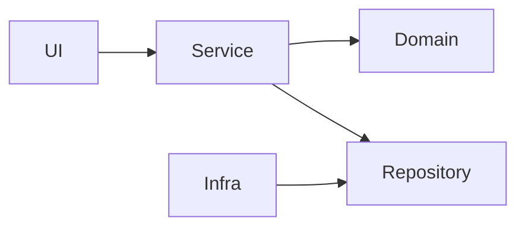
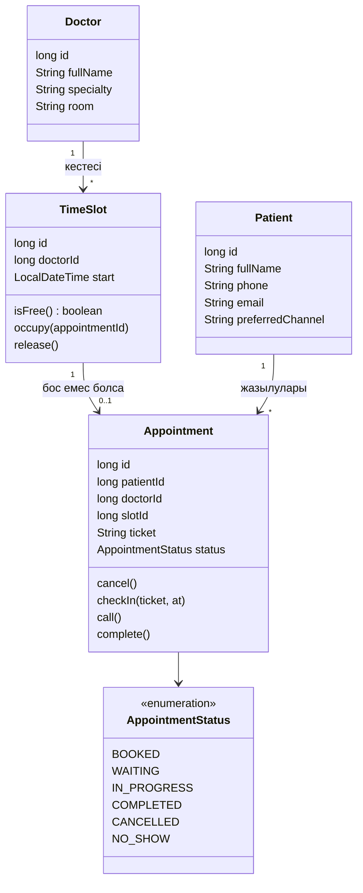

# Emhana — Clinic Appointment Booking & Queue

> Capstone project — Application Design Based on Patterns (Design Patterns), 4th year, Information Systems.

**Team:** Alisher Koshkinbay (`@alisherkoshkinbay`), Zhuldyzkhan Takhanov (`@juldyzkhan`)
**Domain:** Емхана пациенттері дәрігердің бос уақытына жазылады, қажет болса бас тартады және еске салғыш алады, ал тіркеуші келген пациентке талон беріп, дәрігер оны кезектен шақырады.

## Quick start
```bash
mvn verify                      # build + tests + coverage gate
mvn exec:java -Dexec.mainClass=kz.kaznaru.capstone.App   # or press F5 in VS Code
```

## Architecture
<!-- Insert a Mermaid class/component diagram here. -->


## Domain model


## Patterns used
See [docs/PATTERN_REGISTER.md](docs/PATTERN_REGISTER.md). Decisions: [docs/adr](docs/adr).

## Team workflow
Branch per issue, pull request per branch, one teammate review before merge.
